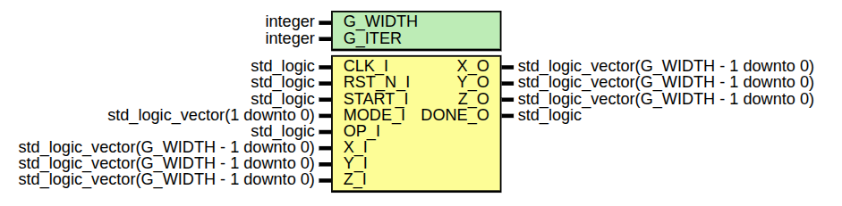

# Cordic
Implementación del Algoritmo Cordic en VHDL

## Configuración del Cordic
 | Configuración | Rotación | Vectorización |
 |---------------|----------|---------------|
 | Lineal | Op Y = X*Y | Op Z = X/Y |
 | Hiperbólica | Op X = CosH(X)/ OpY = SinH(X) | Op Z = ArcTanH |
 | Circular | Op X = Cos(X) / Op Y = Sin(Y) | Op Z = ArcTanH(Y) / Op X = SQRT(X^2 + Y^2) |

 ## Fórmulas

 X_i+1 = X_i - d_i·Y_i·2^i

 Y_i+1 = Y_i + X_i·d_i·2^i

 Z_i+1 = Z_i - d_i·e_i

 | Configuración | e_i |
 |---------------|-----|
 | Lineal | 2^-i |
 | Hiperbólico | ArcTanH(2^-i) |
 | Circular | ArcTan(2^-i) |
 
 ## Modo de operación (MODE_I)
 
 | Modo | Configuración |
 |------|---------|
 |  00  | Circular |
 |  01  | Linear |
 |  10  | Hiperbolico |
 
 ## Operación del Cordic (OP_I)
 
 | Valor | Operación |
 |-------|-----------|
 |   0   | Rotación |
 |   1   | Vectorización |